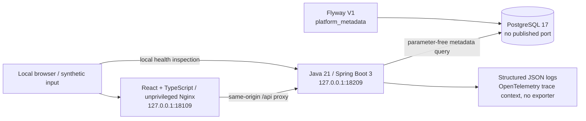

# Architecture

## Phase 1 runtime

All runtime services use the isolated, internal `clueso_runtime` Compose network.
Web/API additionally join `clueso_edge` for loopback port publication; Docker 29
does not publish ports when a container has only an internal network. The edge
network permits egress, but no application functionality needs Internet access.
Build/tool containers may
download public dependencies; no project source or data is uploaded to a cloud
service. A separate synthetic test database has no host port and is not the
runtime database.

To avoid exhausting Docker's shared default address pools, new application
networks use explicit local subnets: runtime `198.18.109.0/28` and edge
`198.18.109.48/28`. The already-created tooling and test networks retain their
Docker-assigned subnets rather than being reset. This reserved benchmark block is
local-only, was checked for overlap, and must not be routed to external systems.

## Ownership and interfaces

| Location                                  | Responsibility                                                                                                                      |
| ----------------------------------------- | ----------------------------------------------------------------------------------------------------------------------------------- |
| `apps/web`                                | Scroll-led presentation, WebGL2 particle field, accessible diagnostic form, typed response handling, explicit errors, static build. |
| `services/api`                            | Validation, migrated metadata read, health, structured logging and trace context.                                                   |
| `packages/contracts`                      | OpenAPI definition of implemented Phase 1 endpoints only.                                                                           |
| `infra/docker`                            | Isolated Compose stack and Nginx proxy/security headers.                                                                            |
| `tests/e2e`                               | Real Chromium tests against the built, running stack.                                                                               |
| `scripts`                                 | Container-only build, verification, local-secret setup, evidence collection.                                                        |
| `docs`                                    | Requirements, decisions, safety, plan, observed evidence and status.                                                                |
| Future `services/worker` and `benchmarks` | Not scaffolded as pretend implementations; reserved for later phases.                                                               |

The browser uses relative `/api` requests. No permissive CORS policy is required.
The API accepts JSON but has no user-facing mutation. Database credentials are
generated locally and supplied as Compose secret files, not committed values.

## Web presentation layer

The page is one React tree over a fixed, non-interactive canvas. Everything that
animates subscribes to a single frame ticker (`motion.ts`), which also steps
smooth scrolling, so scroll position and time are read once per frame.

- `field/shapes.ts` samples six target forms deterministically; `field/engine.ts`
  uploads them once and draws all particles in one call. Sections declare which
  form they want and where with `data-form` attributes; the engine interpolates
  between neighbouring stops from the scroll position and fits each placement to
  the viewport (`field/layout.ts`).
- The engine reports through `data-state`, `data-renderer`, `data-glow` and
  `data-ready` on its host element and two callbacks (current form, live particle
  count). React never reads GL state during render.
- Three rendering tiers: GPU (60,000 particles, or 26,000 on small or touch
  screens, with a bloom pass), software renderer (6,000 particles, no bloom),
  and no WebGL2 (static SVG). Slow frames reduce the particle count, then drop
  the bloom.
- `LiveLab` owns the real check and only announces its outcome with a
  `clueso:pulse` window event; the field has no knowledge of the API.
- Pausing motion or a system reduced-motion preference stops the ticker-driven
  effects, disables smooth scrolling, and renders the field as still frames that
  snap to the current section. With the system preference set at load, the
  preloader is skipped as well.

The canvas, grain and cursor are `aria-hidden`; all content and controls are
ordinary DOM above them.

## Data and migrations

Flyway owns `flyway_schema_history`. V1 creates one constrained singleton
`platform_metadata` row with schema version 1. There are no tutorial/domain tables
yet. Migrations are immutable once applied; Flyway clean is disabled.

The metadata read is also part of readiness. A database connection alone must not
make an unmigrated instance ready. Liveness does not depend on PostgreSQL.

The baseline is additive. Reversing it would destroy the singleton and migration
history, so no automated rollback or volume deletion is provided. Any destructive
reset needs explicit approval; forward migrations are the normal evolution path.

## Toolchain and reproducibility

- Java 21 and Maven 3.9.11 run in the verified Maven container.
- Spring Boot stays on the guide's 3.x line (3.5.16 available from Maven Central).
- Node 22 runs in the existing supported container (observed v22.23.4).
- TypeScript 5.9.3 is selected because the current TypeScript ESLint peer range
  excludes TypeScript 7. A lockfile pins the complete npm resolution.
- Vite builds static assets; the runtime web image contains neither Node nor npm.
  Runtime web dependencies are React, `lenis`, and two self-hosted font packages;
  WebGL2 is used directly. Asset inlining is off so fonts stay CSP-compatible.
- Nginx serves the HTML shell with `Cache-Control: no-cache`.
- Playwright's package and browser-image versions must match. Its container has
  no GPU, so browser tests exercise the software-renderer tier.
- Maven tests use a separate real PostgreSQL service, not H2 or an exposed Docker
  socket. Verification runs sequentially to bound CPU and memory use.
- Runtime images copy artifacts compiled in CPU/memory-limited tooling services.
  They do not run uncapped compiler stages inside Docker builds. Nginx uses one
  worker rather than selecting workers from the shared host's CPU count.
- Node tooling and Playwright share the generated `clueso_node_modules` volume.
  This avoids Windows bind-mount permission/locking failures during npm restores.
  Source and evidence still reside in the project; no host Node installation is
  required and no existing host dependency directory is manually removed.

## Deferred architecture

Future contracts include recording tutorials, comparing versions, and reading
tutorial changes. Future tables include tutorials, steps, snapshots, component
links, recordings, and change requests. These are planning context only.

Redis, Kafka, worker processes, external telemetry export, AI adapters, and
AWS/Kubernetes are intentionally absent. Introducing any of them requires the
appropriate later phase and an explicit need; cloud actions require approval.
